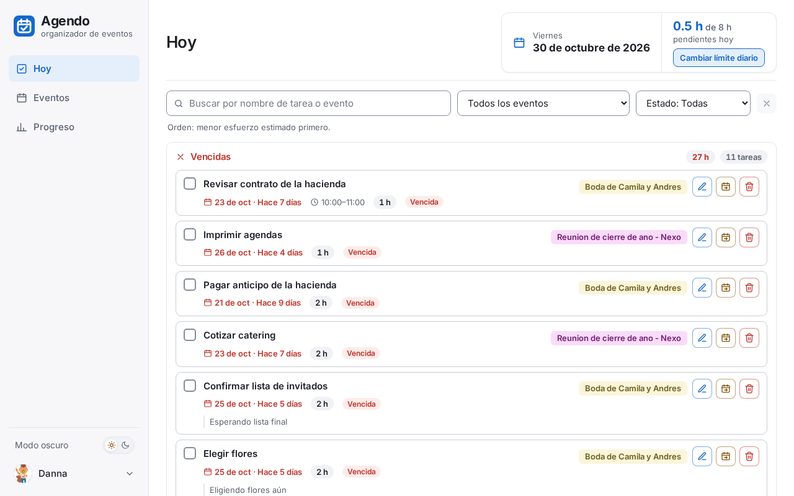
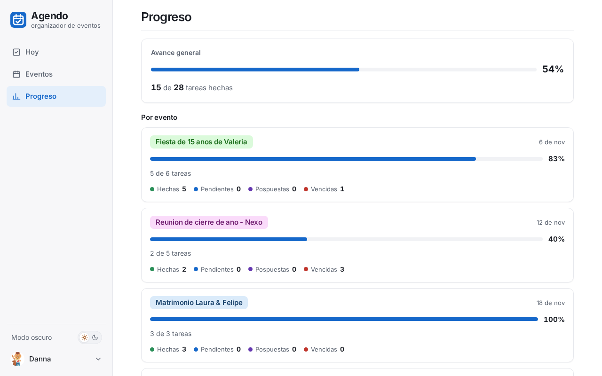
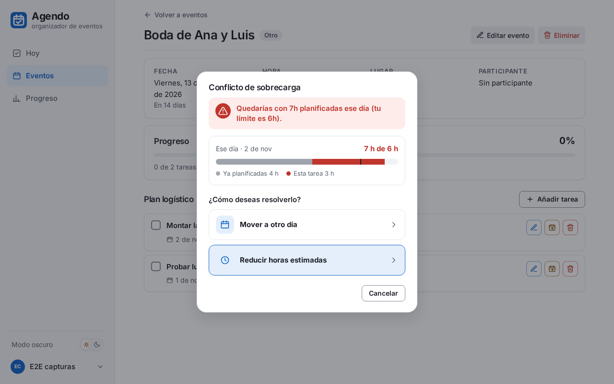
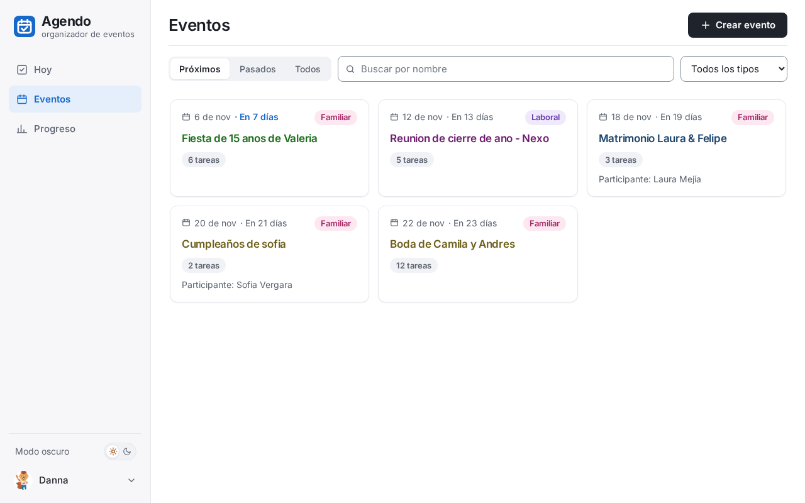

# Agendo — Frontend

Interfaz web de **Agendo**, un organizador de eventos independientes: cada usuario crea sus eventos, planifica las tareas que necesita para sacarlos adelante sin pasarse de su límite diario de horas y, en la vista **Hoy**, ve de un vistazo lo vencido, lo de hoy y lo próximo.

Proyecto del Miniproyecto 1 de Proyecto Integrador I (Universidad del Valle), desarrollado en equipo por sprints.

> ### Cuenta demo
>
> **App:** https://mini-proyecto-1-pi-1.inmemorialake.dev
> **Correo:** `danna@gmail.com` · **Contraseña:** `Danna.2026`
>
> Tiene 5 eventos con tareas vencidas, de hoy, próximas, pospuestas y hechas, y un límite diario de 8 h.

**Backend:** [Miniproyecto-1-PI-1/BackEnd](https://github.com/Miniproyecto-1-PI-1/BackEnd) · **API:** https://backend-h0fc.onrender.com

> **Nota:** el backend está desplegado en el plan gratuito de Render, que se suspende tras un rato sin tráfico. Si el inicio de sesión tarda en la primera carga, espera cerca de un minuto mientras el servidor arranca (puedes abrir https://backend-h0fc.onrender.com/api/health para despertarlo); después la app responde con normalidad.



## Cómo evaluar (T1–T4)

Todo se hace en producción con la cuenta demo. Los pasos crean un evento de prueba propio para no depender de los datos existentes; al final puedes borrarlo con **Eliminar** en su detalle.

### T1 · Crear un evento con tareas

1. Inicia sesión con `danna@gmail.com` / `Danna.2026`.
2. Ve a **Eventos** → **Crear evento**.
3. Llena **Nombre del evento** (p. ej. «Prueba T1»), **Fecha** (dentro de dos semanas) y **Lugar**.
4. En **Tareas**, llena la primera fila: **Tarea** «Alquilar sillas», **Fecha límite** un día de la próxima semana (llámalo *día X*), **Duración** → **Horas estimadas** → `5`.
5. Pulsa **Añadir tarea** y llena la segunda: «Comprar flores», **Fecha límite** otro día (*día Y*), **Horas estimadas** `4`.
6. Pulsa **Guardar evento**. Verás «Evento creado exitosamente.» y la tarjeta del evento con «2 tareas».
7. Abre la tarjeta: el detalle muestra las dos tareas con su fecha y sus horas, y el progreso «0 de 2 tareas ejecutadas».

### T2 · Vista Hoy

1. Ve a **Hoy** (`/hoy`).
2. Arriba a la derecha está la carga del día: **«X h de Y h pendientes hoy»**, es decir, las horas de tareas sin hacer con fecha de hoy frente al límite diario.
3. Las tareas se agrupan en **Vencidas**, **Para hoy** y **Próximas** (hasta 60 días); cada grupo muestra sus horas pendientes y cuántas tareas tiene. «Próximas» enseña las 5 primeras y el resto con «Ver todas».
4. **Regla de prioridad:** dentro de cada grupo va primero la de **menor esfuerzo estimado** (menos horas); si empatan, la de fecha límite más cercana. La app lo recuerda con «Orden: menor esfuerzo estimado primero.»
5. Los filtros permiten buscar por nombre, filtrar por evento y por estado (Pendientes, Pospuestas, Todas).

### T3 · Reprogramar con conflicto de sobrecarga

Con el evento de T1 (día X: 5 h, día Y: 4 h, límite 8 h):

1. En el detalle del evento, pulsa el botón **Posponer** (icono de calendario) de «Comprar flores».
2. En **Nueva fecha** elige el *día X* y pulsa **Posponer**.
3. Aparece el diálogo **«Conflicto de sobrecarga»** con la frase **«Quedarías con 9h planificadas ese día (tu límite es 8h).»** y una barra «9 h de 8 h». No se guarda nada.
4. Resuélvelo de una de dos formas:
   - **Mover a otro día:** muestra hasta tres días con espacio (el primero ya marcado) o deja elegir otra fecha. Pulsa **Mover tarea** → «Tarea reprogramada.» y la tarea queda en el nuevo día.
   - **Reducir horas estimadas:** el campo **Nuevas horas estimadas** propone lo que cabe (aquí 3 h). Pulsa **Guardar** → «Horas reducidas.» y la tarea queda en el *día X* sin pasar del límite.

> Si el *día X* ya tenía otras tareas de la cuenta demo, las cifras cambian, pero el conflicto aparece igual mientras la suma supere 8 h.

**Cambiar el límite diario:** en **Hoy**, botón **«Cambiar límite diario»** (lleva directo al campo), o desde el menú de usuario → **Configuración** → **Planificación** → «Límite diario de horas de trabajo» (entre 1 y 16 h) → **Guardar**. Si algún día desde hoy ya supera el nuevo valor, la app explica cuál y no lo guarda.

### T4 · Marcar tareas como hechas y ver el progreso

1. En el detalle del evento de T1, marca la casilla de una de sus tareas.
2. Verás «Tarea marcada como hecha.», la barra de **Progreso** sube a **50 %** y el texto cambia a «1 de 2 tareas ejecutadas».
3. Ve a **Progreso** (`/progreso`): el evento aparece con la misma barra al 50 % y su desglose (hechas, pendientes, pospuestas, vencidas); arriba está el avance general de todos los eventos.
4. En **Hoy**, la tarea hecha aparece tachada y ya no suma en las horas pendientes. Desmarcar la casilla la reabre.







## Funcionalidades

- **Cuenta:** registro, inicio de sesión con JWT, sesión persistente y cierre automático si el token vence.
- **Eventos:** crear, editar, eliminar y buscar eventos, con tipo de evento, participante opcional y número de tareas.
- **Tareas:** crear, editar, eliminar, posponer (con nota) y marcar como hechas, con fecha límite y horas estimadas u horario.
- **Hoy:** tareas vencidas, de hoy y próximas de todos los eventos, con horas pendientes frente al límite diario, filtros, búsqueda y acciones rápidas.
- **Límite diario y sobrecarga:** si una tarea deja un día por encima del límite, la app ofrece moverla a un día con espacio o reducir sus horas.
- **Progreso:** avance general y por evento, con el desglose de hechas, pendientes, pospuestas y vencidas.
- **Configuración:** foto de perfil (recortada a 256×256 en el navegador), datos personales, límite diario, cambio de contraseña y eliminación de cuenta.
- **Tema claro y oscuro:** sigue la preferencia del sistema la primera vez y se cambia desde el sidebar o el login.

## Stack

| Capa | Tecnología |
| --- | --- |
| UI | React 19 |
| Build | Vite 8 |
| Enrutamiento | React Router 7 |
| Estilos | Tailwind CSS 4 y CSS Modules, con tokens de color en `src/styles/tokens.css` |
| Linting | oxlint |
| Pruebas | Vitest + Testing Library (unitarias), Playwright + axe-core (e2e y accesibilidad) |
| Despliegue | Vercel |

## Estructura

```
src/
├── api/          Cliente HTTP hacia el backend
├── components/   Componentes reutilizables
├── context/      Contexto de sesión (AuthContext)
├── hooks/        Hooks propios (sesión, tema, peticiones, cambios sin guardar)
├── pages/        Vistas de cada ruta, con estilos en CSS Modules
├── styles/       Estilos globales y tokens de color
├── utils/        Funciones auxiliares
└── data/         Catálogos estáticos (tipos de evento)
e2e/              Pruebas de punta a punta y de accesibilidad (Playwright)
```

## Puesta en marcha

Requisitos: Node.js y el [backend](https://github.com/Miniproyecto-1-PI-1/BackEnd) corriendo (en local o el desplegado).

```bash
npm install
cp .env.example .env   # ajusta VITE_API_URL si el backend no está en localhost:8080
npm run dev
```

| Script | Qué hace |
| --- | --- |
| `npm run dev` | Servidor de desarrollo en http://localhost:5173 |
| `npm run build` | Build de producción en `dist/` |
| `npm run preview` | Sirve el build localmente |
| `npm run lint` | Revisa el código con oxlint |
| `npm test` | Pruebas unitarias (Vitest) |
| `npm run test:e2e` | Flujos T1–T4 de punta a punta (Playwright) |
| `npm run test:a11y` | Revisión de accesibilidad WCAG 2.1 AA con axe |

## Pruebas

```bash
npm test               # 53 pruebas unitarias con Vitest (jsdom)
npx playwright install chromium   # solo la primera vez
npm run test:e2e       # flujos T1–T4 contra producción
npm run test:a11y      # axe en /hoy, /crear, /evento/:id, /progreso y /configuracion (tema claro y oscuro)
                       # y recorrido con Tab de /evento/:id y /progreso comprobando que el foco se ve
```

Las pruebas e2e (`e2e/*.e2e.js`) corren por defecto contra producción. Para apuntar a otro despliegue usa `E2E_BASE_URL` (frontend) y `E2E_API_URL` (backend), por ejemplo `E2E_BASE_URL=http://localhost:5173 E2E_API_URL=http://localhost:8080 npm run test:e2e`.

Cada archivo registra un **usuario temporal** con límite diario de 6 h, crea sus eventos por API y lo borra al terminar (`DELETE /api/users/me`), así que no tocan la cuenta demo. Antes de empezar despiertan la API (`/api/health`, hasta ~90 s). Una prueba falla si la página registra errores en consola, salvo el 409 esperado del conflicto de sobrecarga. El reporte HTML queda en `e2e/playwright-report/` (ignorado por git): ábrelo con `npx playwright show-report e2e/playwright-report`.

## Variables de entorno

| Variable | Descripción |
| --- | --- |
| `VITE_API_URL` | URL del backend Spring Boot, por ejemplo `http://localhost:8080` |

## Equipo

| Integrante | GitHub |
| --- | --- |
| Andrés Gerardo González Rosero | [@Inmemorialake](https://github.com/Inmemorialake) |
| Victoria Yuan Chen | [@ycvictoria](https://github.com/ycvictoria) |
| Freddy Alexander Melo Buitrago | [@Alexander-Motion](https://github.com/Alexander-Motion) |
| Andrés Felipe Narváez Bolaños | [@andres042](https://github.com/andres042) |
